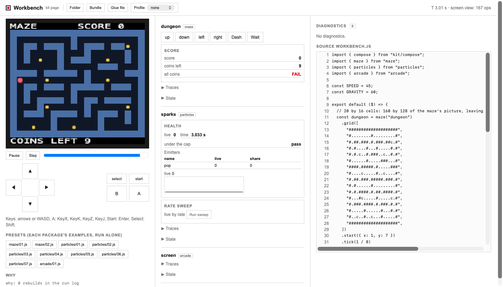

# kit/page/host: the workbench page

One HTML page, a thin host on the kit ([the draw-list draft](../../../project/2026-11-26-draw-list-draft.md), Ben's ruling of 2026-11-26): load Dialect packages and a glue workbench, play it, inspect it. Every decision is the kit's (kit/package loads, kit/compose checks and builds, kit/run runs, [kit/page](../README.md) draws); the modules here hold the page's own glue and are tested without a DOM. No new dependency.

Serve the **repository root** and open the page (ES modules do not load from `file://`):

```
python3 -m http.server 8765        # from the repo root
# http://127.0.0.1:8765/kit/page/host/index.html?workbench=/scripts/draw-trial/massaged/2026-11-26-compose/workbench.js
```



## Loading

| Way | |
|---|---|
| `?workbench=<glue>` | the glue file, fetched; its packages are the folders beside it named by its imports (`import { maze } from "maze"` is `<glue dir>/maze/`) |
| `&packages=<dir>,<dir>` | the package folders instead; each one's `wb-package.json` is fetched, then each file it lists whose path kit/package's path rule accepts (`isPackagePath`: one that climbs out of the folder or names another host is never fetched; kit/package reports it, K002). Every file is held as its bytes, as fetched: kit/package's `textOf` decides what is text, keeping a BOM and refusing bad UTF-8, so a file's hash is over its bytes (**corrected 2026-11-26**, review M4.3, leaf `sr8Yp1`: the host decoded each `.js` file and the manifest with a default `TextDecoder`, which strips a BOM and replaces bad bytes, and fetched every listed path before kit/package checked it) |
| `&profile=canvas\|gameboy` | the renderer profile the composition is checked against (S401, and H001 at draw time) |
| `&preset=<package>/<example>` | one package's example, run alone as a one-part composition |
| Folder | a picker: every folder holding a `wb-package.json` is a package; the `.js` file outside them (`workbench.js` when there are several) is the glue |
| Bundle | a `wb-bundle` JSON file, one package (`scripts/pkg/bundle.js`), through kit/package's `readBundle` |
| Glue file | a glue `.js` file |

Paths in the query resolve against the page's URL, so start them with `/` for a path from the repo root. A missing file is a diagnostic naming its URL.

Packages load through `rewriteSpecifiers` and blob URLs (`kit/define` and `kit/compose` become the real modules' URLs, so one instance of each is shared); the glue's bare package names become each package's Grammar module. A Program file (the glue, an example) gets the module scope epilogue (kit/define's `withScope`), and its build options are kit/define's `moduleScope`. A preset is kit/page's `examplePreset`: a build-time read of `$` gets the declared value, and an edit of such a param rebuilds the part (`Loaded.rebuild`, passed to the run as `build`). A glue is kit/compose's `rewriteGlue` (its imports, from the URLs the host made) and `callGlue` (its default export called, and what went wrong as S103, S104 or the kit code thrown); the host only imports the rewritten text.

A custom element's module is named as the UI names it, relative to the UI module (kit/package's `elementModulePath` reads the manifest and decides the path, the one its `elements` check used; `elementModuleUrl` returns `{ url, diagnostics }`, a bad manifest being a K diagnostic that the page lists, not a silent null; until leaf `sr8Yp1` the host stripped `./` and looked it up from the package's root). A session's `stop()` also aborts every running sweep and silences its `onFrame`, so a reloaded page never receives the old session's snapshots. A stopped session is final: a sweep asked of it afterward runs nothing and returns cancelled, and `start()` throws (verify-34). A snapshot or panel that throws (a Dialect's `text` for a custom element stage, say) is one diagnostic while it repeats, not one per frame, and the frames go on (the session's `onProblem`). The param editors show the run's values and are built again after a scrub, and after an edit the run refused.

**Diagnostics are never swallowed.** The right column lists every K, S, U, H, N and J diagnostic with the kit's own text, grouped by source (package, glue, composition, page, run, host), and anything the page itself catches (`error`, an unhandled rejection) is a `LOAD` entry. A halted frame loop (H004) says so, and Resume restarts it.

## The page

- **Stage.** The shown part's Draw output on a canvas through `createPage`, scaled with `image-rendering: pixelated`. A shown part with no Draw output (H002) shows its UI's custom element stage when the module loads, else the Dialect's text view; a shown layer always draws and has no package of its own, so the fallback never applies to it. Keys go through `page.key` (`preventDefault` when it returns true), and pointer events on the canvas through `page.pointer`, in canvas pixels. A page whose Controls take keys starts locked: a **Click to start** overlay over the stage is its one gesture (`page.unlock`), and a window blur lets go of every held Control (`page.blur`).
- **Controls** (declared Controls, 2026-11-27). The generated `controls` view under the stage: one on-screen form per wired Control, in declaration order, then each part's part-local Controls, from `session.forms()` (`views.js`'s `controlForm`): buttons laid out by the Control's `grid`, a row of triggers, a slider, a checkbox, a menu, a text field (which takes the keys while focused), a color well, a vector's components (a slider and number each, clamped to `min..max`), a point list (move, add up to `max`, remove; clamped to `x` and `y`), and a pick (a filter and a list of the declared data file's rows, sending `{ value: <key>, <carried columns> }`; `controlForm`'s fourth argument is the `data(form)` file resolver, `pick-data.js`'s `dataFileOf(loaded)`, and a file the page cannot read is said on the form). A keyed Control (the form's `keyed`) shows one form per instance of every kind, each sending the instance's `key`; a scoped Control (named `<part>.<control>`, the form's `part`) is tagged with its part and shown by its control's name; a slider whose Control has `to` previews while it moves and commits when it is let go, and is disabled with its H011 when its target cannot be written. Each change goes through `session.control(name, record, event?)`, which is kit/page's `page.control`; a release of a Control with `to` hands its commit `{ part, to, value }` to the session's `onCommit`. The page passes none yet: with no editor stage, a commit is not written into the text (the live value and a part-local preview still play). The host has no pad of its own: the fixed D-pad, A, B, Start and Select are gone. **Device inputs** (`input-devices.js`, `createInputDevices`): a gamepad polled once per animation frame (the first connected pad, against its last state, stamped with the pad's own `timestamp`) and Web MIDI listened to after the page's one gesture (`listen()`, called from `page.onUnlock`; inputs plugged in later too, stamped with each message's `timeStamp`), through kit/page's `gamepadRecords`, `midiRecords` and `midiAccess`, only for Controls that declare `gamepad` or `midi` (a keyed one declares neither, U017) and never while the page is locked. No MIDI asked for when no Control declares it; absent or refused MIDI is one H014 and the other devices go on. The pad is not read when no Control declares one.
- **Run control.** Pause, Step (one instant) and a time scrubber: moving it rewinds through `run.rewind`, and runs forward as far as the furthest point reached.
- **Per part** (each part but the page and a layer, which have no state, params or UI of their own). Its tiles (`stat`, `check`, `table`, `plot`, `runs`, `text`, `row`, `col`: the values from kit/define's `ui.compile(record).evaluate(state, $)`, the part's UI Kernels, each ~0.1 s; [ui-eval.js](ui-eval.js) shows them as text and keeps the plot histories; a `runs` tile sweeps on a click, through kit/page's `sweepRuns`, in slices that yield, so the page stays live: the button shows the progress and cancels, a rerun cancels the sweep before it, and each sweep is kept by part and component id, so two parts' tiles with one label are two sweeps (**corrected 2026-11-26**, review M3 and M4.6, leaf `sr8Yp1`: a sweep ran on the main thread to the end, about 42 minutes for the particles preset at defineUI's limits, and was kept by its label alone), its params (editable: a `param` input, with the compiled UI's annotations; the value shown and handed to the UI as `$` is kit/run's `run.params(part)`, so it follows a rewind; an edit outside the param's declaration is refused by the run, N008, and listed in the diagnostics; **corrected 2026-11-26**, review H1 and H2, leaf `1Bfx8t`: the host kept its own map of edits, which outlived a rewind, and applied an edit unchecked, so one past a build-time param's range halted the page, H004), its generated traces (a series per number outside a list) and its state.
- **Why** is `page.why()`. **Source** is the glue (or the preset's example) read-only with line numbers. **Presets** are each package's `examples`, loaded alone. A package with manifest `tests` also gets a **Tests** row under Presets (leaf `ceE4ib`; optional: a package with none has no row): a Run button that calls `runLoadedTests` (kit/page's `runTests` for each package, in slices, with progress and Cancel), then each test's name with pass or fail, and its H006–H008 listed in the diagnostics under a **tests** group. A failed test has **Open**: it loads the test's example as a preset with the page's controls unwired (`loadPreset`'s `wirePage: false`) and the test's log as the run's inputs (`createSession`'s `run` option), paused at the instant its expectation read (`session.seek`), so you can step, scrub and read Why from there. A part played alone gets the page's Controls through its Event inputs (kit/page's `examplePreset` wires `page.out.<control>` to the input of that name, given the package's UI), so the on-screen forms and the keys send page inputs.

## Files

`index.html` and `host.css` (the one inline script holds the page's only dynamic import: the kit's modules may not hold one, `kit/test/browser-safe.test.js`), `main.js` (DOM wiring), `views.js`, `widgets.js` (the vector, points and pick widgets), `dom.js`, and the tested logic: `pick-data.js` (a pick's CSV or JSON rows, its record, and the data-file resolver), `input-devices.js` (gamepad polling and MIDI listening), `load.js` (packages, glue, preset, diagnostics), `sources.js` (query, fetch, upload, bundle), `session.js` (page + scrubber + inputs + the Controls' forms + snapshot), `layout.js` (`layoutOf(uis, views)`: each generated view a root, tabWith making tab groups and the splits a tree, tested without a DOM; `main.js` does not lay its panels out by it yet), `ui-eval.js` (formatting, plot histories, traces). Tests are in `test/`; the page itself is checked by hand.

## Known limits

- A param edit that build-time code reads rebuilds a preset's part (kit/page's `examplePreset`); a glue's parts have no build-time param reads to rebuild for (a read of the glue's `$` is S104; kit/page's README, "Presets and sweeps"). A glue's `Loaded.rebuild` builds one part again with argument overrides (kit/compose's `callGlue(…, { args })`), which is how a Grip or a part-local Control with `to` previews a glue part's argument. The UIs are compiled once, against the loaded records.
- `checkExamples` is not run; a preset that does not build shows its diagnostic.
- Blob URLs of a replaced workbench are not revoked.
- No editor, in-page agent or book; no Game Boy pixel renderer. So a Control's commit (`onCommit`) and a Grip's release are not written back into the text yet.
